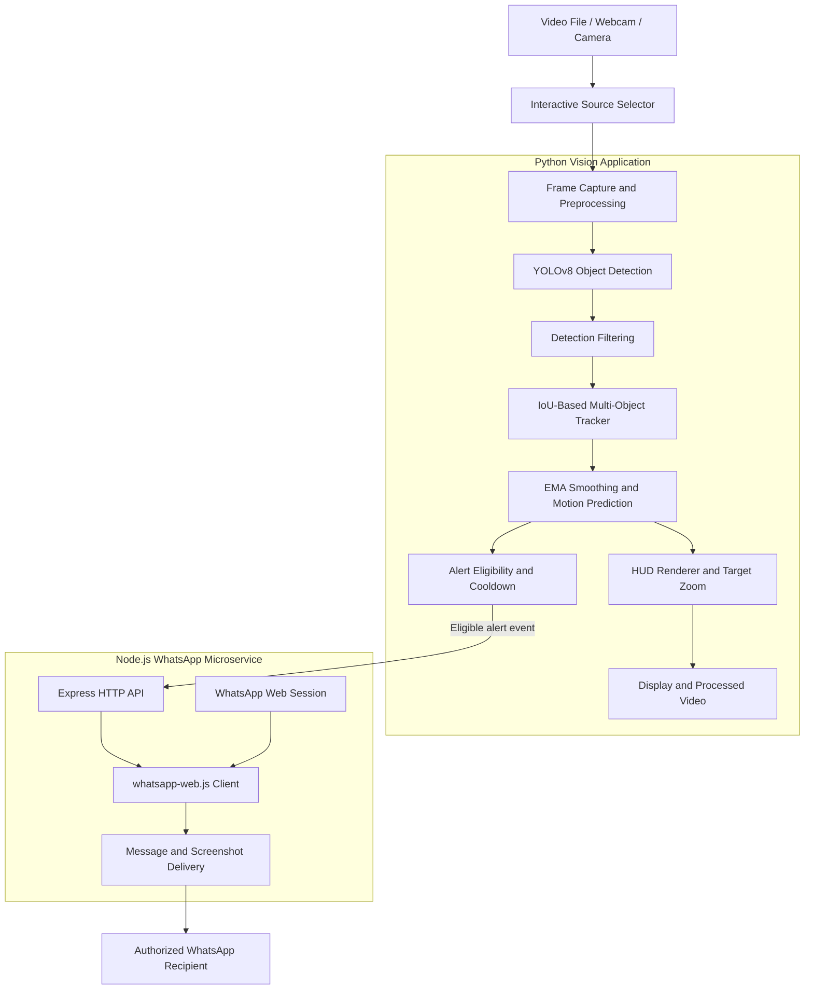
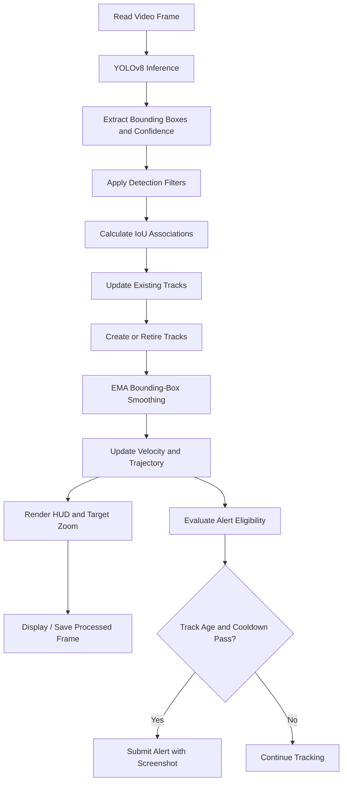
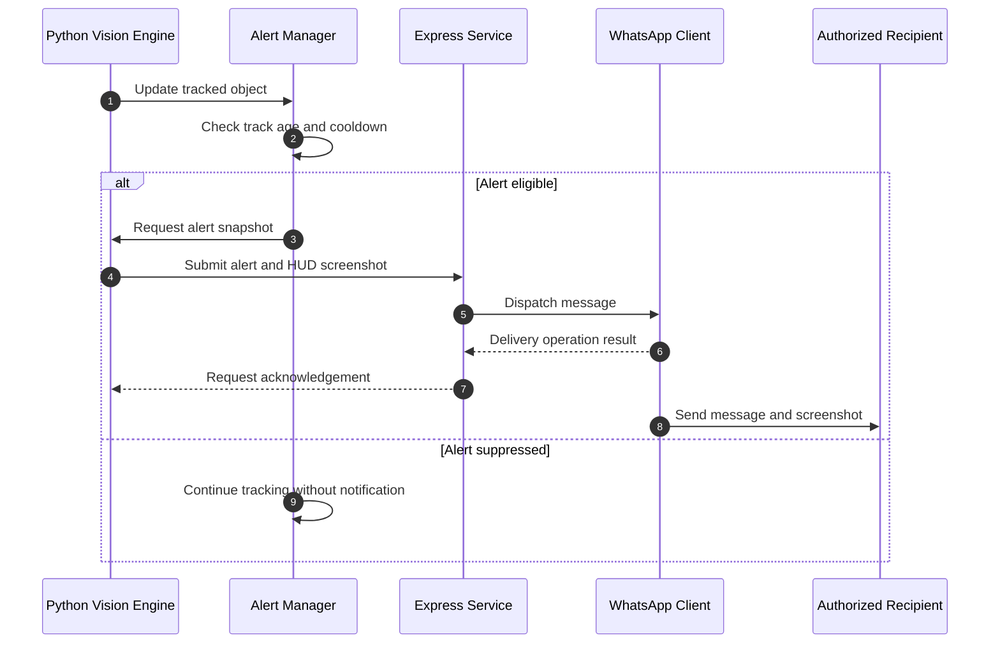

# Real-Time UAV Tracking & Threat Detection System

**A real-time computer vision system for UAV detection, multi-object tracking, trajectory visualization, and event-driven WhatsApp alerts.**

Built with Python, YOLOv8, OpenCV, a custom IoU-based tracker, trajectory smoothing, and a Node.js WhatsApp integration.

---

## Overview

The Real-Time UAV Tracking & Threat Detection System is a computer vision application designed to identify and track drone-like objects in video streams while presenting tracking information through a real-time heads-up display (HUD).

The system combines object detection, lightweight multi-object tracking, trajectory estimation, visual overlays, and asynchronous alert delivery into a modular processing pipeline.

It supports video-file input and camera-based input, with an interactive source selector when no input source is provided.

### Core capabilities

- Real-time object detection using Ultralytics YOLOv8.
- Multi-object tracking using IoU-based detection association.
- EMA-based bounding-box smoothing and velocity-based trajectory prediction.
- HUD visualization with target markers, motion trails, telemetry, and target zoom.
- Filtering for detections that overlap with suspected playback screens and interface overlays.
- Optional WhatsApp notifications with captured HUD screenshots.
- Configurable alert cooldowns and minimum track-age checks.
- Interactive video controls and processed-video output.

**Important:** Detection and tracking identify visual objects and estimate their movement. They do not independently establish that an object is hostile or represents a genuine security threat. Playback filtering is heuristic and does not guarantee spoofing detection.

---

## Table of Contents

- [System Architecture](#system-architecture)
- [Detection and Tracking Pipeline](#detection-and-tracking-pipeline)
- [WhatsApp Alert Workflow](#whatsapp-alert-workflow)
- [Technology Stack](#technology-stack)
- [Project Structure](#project-structure)
- [Prerequisites](#prerequisites)
- [Installation](#installation)
- [Configuration](#configuration)
- [Running the Application](#running-the-application)
- [Keyboard Controls](#keyboard-controls)
- [Performance and Reliability](#performance-and-reliability)
- [Troubleshooting](#troubleshooting)
- [Limitations](#limitations)
- [Security and Privacy](#security-and-privacy)
- [License](#license)

---

## System Architecture

The application uses a Python-based vision pipeline and an independent Node.js service for WhatsApp messaging. The vision pipeline processes video frames, tracks detections, renders the HUD, and submits eligible alert events to the messaging service.

### High-level architecture



### Component responsibilities

| Component | Responsibility |
|---|---|
| Input selector | Selects a video file or camera source |
| Frame processor | Reads and prepares frames for inference |
| YOLOv8 detector | Produces object detections and confidence scores |
| Detection filter | Rejects selected overlapping or likely playback-related detections |
| IoU tracker | Associates detections with existing tracks |
| Motion estimator | Smooths bounding boxes and estimates movement |
| HUD renderer | Draws tracking markers, trails, telemetry, and target zoom |
| Alert manager | Applies track-age and cooldown rules |
| Express service | Receives alert requests from the Python application |
| WhatsApp client | Maintains a linked session and dispatches notifications |
| Output manager | Displays frames and saves processed video when configured |

*This diagram represents the architecture described for the project. Exact API routes and internal module boundaries should match the implementation.*

---

## Detection and Tracking Pipeline

Each frame passes through a series of processing stages before it is displayed or considered for alerting.



### Object detection

The application uses the Ultralytics YOLOv8 model, configured as `yolov8n.pt` in the supplied project description.

The detector returns candidate bounding boxes and confidence values. Detection quality depends on the model's training classes, camera quality, object scale, lighting, and environmental conditions.

### Multi-object tracking

A custom lightweight tracker associates detections across consecutive frames using Intersection over Union (IoU).

For two bounding boxes \(A\) and \(B\):

\[
IoU(A,B)=\frac{|A\cap B|}{|A\cup B|}
\]

Higher IoU indicates greater overlap and can support track association. Actual matching also depends on the implementation's thresholds and association rules.

### Trajectory smoothing

Exponential Moving Average (EMA) smoothing reduces abrupt changes in bounding-box coordinates:

\[
S_t=\alpha B_t+(1-\alpha)S_{t-1}
\]

Where:

- \(B_t\) is the current detected bounding box.
- \(S_t\) is the smoothed bounding box.
- \(\alpha\) controls responsiveness versus smoothness.

Velocity-based prediction can estimate short-term movement when detections are temporarily missing. Such predictions are estimates, not guaranteed object positions.

### HUD visualization

The HUD can display:

- Bounding-box corner markers and target reticles.
- Target identifiers and spatial coordinates.
- Trajectory trails and velocity arrows.
- Processing FPS and timestamps.
- Target counts and tracking telemetry.
- A zoomed, enhanced view of the primary target.

---

## WhatsApp Alert Workflow

The optional Node.js microservice handles messaging separately from the Python tracking loop. This separation allows alert requests to be processed asynchronously rather than performing message delivery directly inside frame processing.



### Alert lifecycle

1. The tracker updates the object's identity and motion information.
2. The alert manager evaluates configured eligibility rules.
3. An eligible event produces a HUD screenshot.
4. The Python application submits the alert to the Node.js service.
5. The service uses its authenticated WhatsApp session to send the notification.
6. Cooldown and track-age rules help reduce repeated alerts.

A successful API response does not necessarily guarantee delivery to the recipient. The implementation should distinguish request acceptance from confirmed message delivery.

### WhatsApp session setup

On the first run, the service may display a QR code in the terminal. Scan it using WhatsApp's **Settings → Linked Devices → Link a Device** workflow.

The linked session is stored locally according to the service configuration. Keep session files private and do not commit them to Git.

---

## Technology Stack

| Layer | Technology |
|---|---|
| Programming language | Python |
| Object detection | Ultralytics YOLOv8 |
| Image and video processing | OpenCV |
| Multi-object tracking | Custom IoU-based tracking |
| Trajectory smoothing | EMA and velocity estimation |
| HUD visualization | OpenCV drawing and image operations |
| Messaging service | Node.js |
| HTTP API | Express.js |
| WhatsApp integration | `whatsapp-web.js` |
| Alert transport | HTTP requests between Python and Node.js |
| Model weights | `yolov8n.pt` |

---

## Project Structure

The following is a conceptual structure based on the supplied description. Preserve the actual filenames and directories in your repository.

```text
UAV-detection/
├── main.py
├── config.py
├── requirements.txt
├── yolov8n.pt
├── whatsapp_bot/
│   ├── package.json
│   ├── server.js
│   └── session-data/
├── sample_videos/
├── outputs/
└── README.md
```

Typical responsibilities:

- `main.py` — frame processing, detection, tracking, HUD rendering, and application controls.
- `config.py` — detection settings, alert options, and recipient configuration.
- `requirements.txt` — Python dependencies.
- `yolov8n.pt` — YOLOv8 model weights.
- `whatsapp_bot/` — Node.js messaging service and WhatsApp session handling.
- `sample_videos/` — optional sample input footage.
- `outputs/` — optional location for processed videos and screenshots.

---

## Prerequisites

Install the following software:

- Python version supported by the project's dependencies.
- Node.js 18 or later and npm.
- A webcam or a compatible video file.
- Internet access for downloading model weights and connecting the WhatsApp service.
- WhatsApp on a device authorized to link the messaging session.

Verify the installations:

```bash
python --version
node --version
npm --version
```

Use a Python version compatible with the installed PyTorch, OpenCV, and Ultralytics releases. Do not assume every dependency supports every Python release equally.

---

## Installation

### 1. Clone the repository

```bash
git clone <YOUR_REPOSITORY_URL>
cd UAV-detection
```

Replace the placeholder with your actual Git repository URL.

### 2. Create a Python virtual environment

Linux/macOS:

```bash
python3 -m venv .venv
source .venv/bin/activate
```

Windows PowerShell:

```powershell
py -m venv .venv
.\.venv\Scripts\Activate.ps1
```

### 3. Install Python dependencies

If the repository includes `requirements.txt`:

```bash
python -m pip install --upgrade pip
pip install -r requirements.txt
```

If dependencies are managed differently, follow the repository's actual dependency configuration.

Ensure the YOLOv8 model weights are available. If they are not included, the supported Ultralytics workflow may download them on first use, depending on network access and configuration.

### 4. Install Node.js dependencies

Open a second terminal:

```bash
cd whatsapp_bot
npm install
```

Run the command from the directory containing the service's `package.json`.

---

## Configuration

Open `config.py` and inspect the supported configuration options.

For example, if these settings exist in the implementation:

```python
ENABLE_WHATSAPP = True
WHATSAPP_TO_NUMBER = "919876543210"
```

- Enable WhatsApp notifications only when needed.
- Replace the example number with the authorized recipient's number, including country code.
- Configure any alert cooldown and track-age thresholds using the actual variable names supported by the project.

Do not commit personal phone numbers, credentials, WhatsApp session data, or other secrets.

If WhatsApp notifications are not required, disable them and verify that the tracking application works independently.

---

## Running the Application

### 1. Start the WhatsApp microservice

In a separate terminal:

```bash
cd whatsapp_bot
npm start
```

If the service prints a QR code, link the authorized WhatsApp account using the official Linked Devices flow.

Wait until the service reports that the client is ready before testing alerts.

### 2. Start the Python tracker

From the project root, activate the virtual environment and run:

```bash
python main.py
```

When no source is supplied, the application can present its interactive input selector.

To specify an input directly, use the supported `--source` argument if implemented. For example:

```bash
python main.py --source path/to/video.mp4
```

For a webcam, use the source identifier expected by the program, commonly a camera index such as `0` if supported.

### 3. Verify operation

- Confirm that model initialization succeeds.
- Check that frames are being processed.
- Verify detections and track identifiers.
- Confirm that HUD telemetry updates.
- Test pause and quit controls.
- Verify that eligible alert events reach the Node.js service.
- Confirm that the processed video is saved when configured.

---

## Keyboard Controls

When the tracking display is active:

| Key | Action |
|---|---|
| `Space` | Pause or resume playback |
| `Q` | Quit the application and finalize output where supported |

Use the actual output configuration to locate saved video files and screenshots.

---

## Performance and Reliability

Actual performance depends on the input resolution, model, hardware, tracking thresholds, and video decoding workload.

Recommended practices:

- Measure detector inference time separately from total frame-processing time.
- Avoid blocking network operations in the tracking loop.
- Keep alert transmission asynchronous.
- Use configurable cooldowns to reduce duplicate notifications.
- Validate screenshots before submitting them to the messaging service.
- Test tracker behavior during occlusion and abrupt movement.
- Monitor memory use during long video sessions.
- Handle camera disconnects, invalid video files, and messaging-service failures gracefully.

A high reported FPS does not by itself establish detection accuracy or threat-detection reliability.

---

## Troubleshooting

| Problem | Suggested checks |
|---|---|
| YOLO weights cannot load | Check the model path, package installation, and network access if downloading is required |
| No objects detected | Check the model's supported classes, input quality, confidence threshold, and lighting |
| Low FPS | Check inference device, frame resolution, and model workload |
| Bounding boxes jitter | Review EMA smoothing parameters and detection stability |
| Tracks switch identities | Review IoU thresholds, association rules, and occlusion behavior |
| WhatsApp QR code does not appear | Check service startup logs and whether a previous session is already authenticated |
| Alerts are not received | Check service readiness, API configuration, recipient format, cooldowns, and error logs |
| Repeated notifications | Verify track-age checks, cooldown state, and event deduplication |
| Camera or video fails to open | Verify the input path, camera permissions, and OpenCV video backend |
| GUI fails in a headless environment | Use a compatible display environment or implement a supported headless output mode |

---

## Limitations

- YOLO detections are dependent on the model's training data and supported object classes.
- IoU association can struggle with heavy occlusion, crowded scenes, and rapid movement.
- EMA smoothing may introduce lag when targets move abruptly.
- Velocity prediction is not a full physical motion model.
- Visual playback filtering is heuristic and may produce false positives or false negatives.
- WhatsApp Web automation depends on session validity and the availability of the messaging service.
- A detected drone-like object does not automatically indicate hostile intent.
- This application should not be treated as a certified aviation, public-safety, or military threat assessment system.

---

## Security and Privacy

- Restrict WhatsApp notifications to explicitly authorized recipients.
- Keep linked-device session files outside source control.
- Avoid including credentials or personal information in logs.
- Validate incoming alert requests and restrict access to the messaging service.
- Protect screenshots and processed videos, which may contain sensitive visual information.
- Use the system only with appropriate authorization and in compliance with applicable privacy, aviation, and surveillance laws.

---

## License

Add the applicable license file and update this section to reflect the project's actual licensing terms.

---

## Author

**Praveen Reddy**

GitHub: [@reddy895](https://github.com/reddy895)

